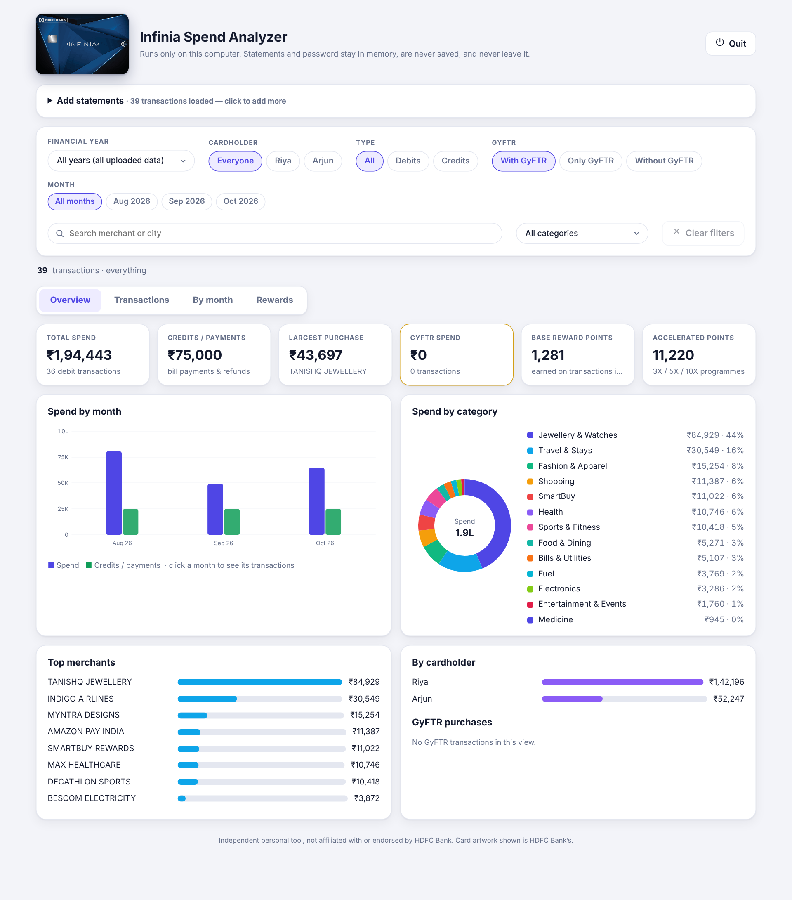
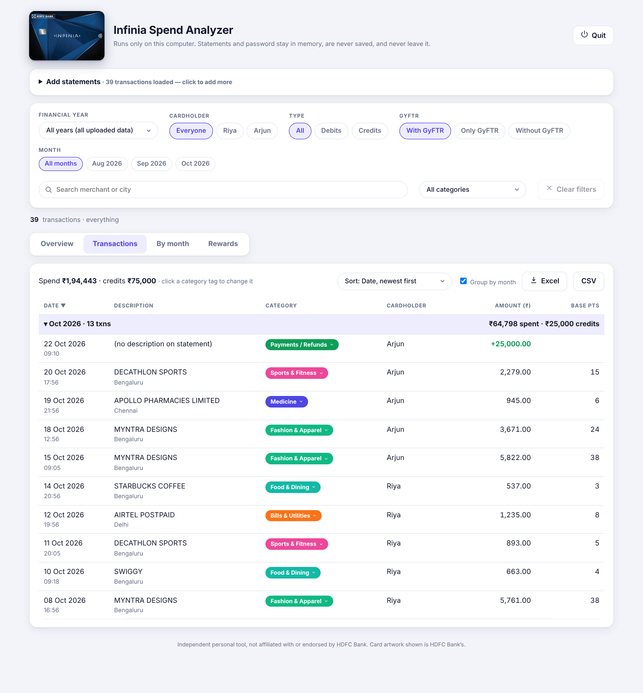
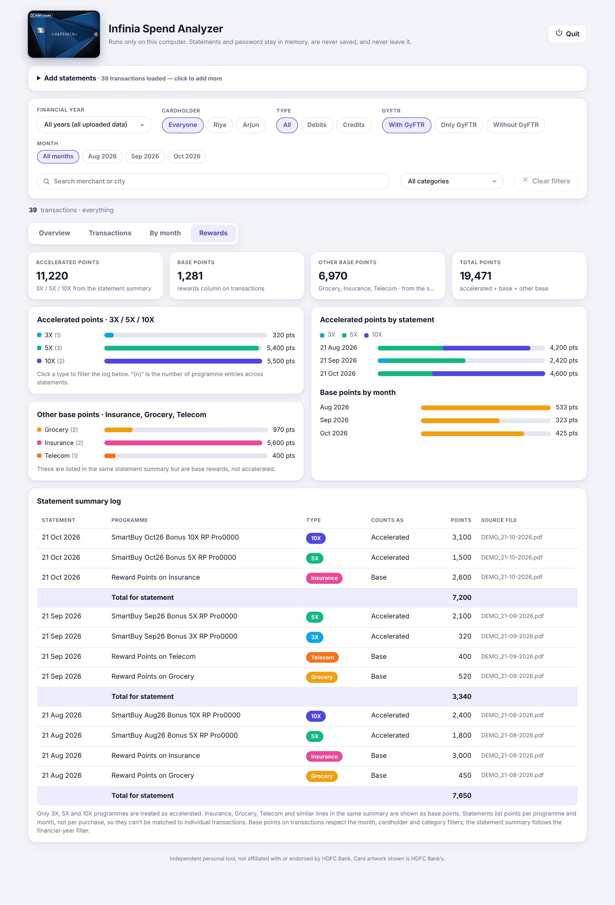

# Infinia Spend Analyzer

A private, offline tool that reads **password-protected HDFC Infinia credit card statement PDFs** and turns them into a clean dashboard: spend by month and category, cardholder split, GyFTR spend, and reward points (accelerated 3X / 5X / 10X vs base), sorted by Indian financial year (1 Apr – 31 Mar).

**Your statements and password never leave your computer.** There is no server, no account, no analytics and no network calls while you use it. Everything runs on `127.0.0.1` and is held in memory only.

| Transactions | Rewards |
|---|---|
|  |  |

## Features
- Open several statements at once (same password), merged and de-duplicated
- Financial-year filter (current FY ±3 years), cardholder, month, type, GyFTR, category and search filters, with one-click **Clear filters**
- Smart categorisation (about 30 categories, e.g. Medicine, Fuel, Travel, Insurance) that **remembers your corrections** per merchant
- Credit vs debit detected from the statement's green amounts, so bill payments are not counted as spend
- Rewards tab: accelerated points (3X/5X/10X) separated from base and category points
- Sort and export to Excel / CSV

## Try it with the demo data
`samples/` has three **fictional**, password-protected statements. The password is `demo1234`. Names, merchants and amounts are invented.

## Run it
You need Python 3 on your computer. On the first run the launcher installs `flask`, `pdfplumber`, `pandas` and `openpyxl` into its own private environment.

- **Mac:** run `python3 scripts/build.py`, unzip `dist/Infinia-Spend-Analyzer-Mac.zip`, right-click the app → **Open** (it is unsigned).
- **Windows:** run `python scripts\build.py`, unzip `dist\Infinia-Spend-Analyzer-Windows.zip`, double-click `Start-Infinia-Spend-Analyzer.bat` (choose *More info → Run anyway* if SmartScreen appears).
- **Any OS, from source:** `pip install flask pdfplumber pandas openpyxl && python src/app.py`

Prebuilt zips are available on the Releases page.

## Privacy
See [PRIVACY.md](PRIVACY.md). In short: nothing is uploaded, the password is never written to disk, and the only file saved is your merchant-to-category choices.

## Limitations
- The parser is tuned to the **HDFC Infinia** statement layout. Other cards or banks will likely need new parsing rules.
- Statements list accelerated points per programme and month, not per purchase, so points cannot be matched to individual transactions.
- Not tax or financial advice. Always check figures against your statement.

## Disclaimer
This is an independent personal project. It is **not affiliated with, endorsed by or sponsored by HDFC Bank**. "HDFC Bank" and "Infinia" and the card artwork are trademarks of their owners and are shown only to identify the card this tool is made for.

## Licence
MIT. See [LICENSE](LICENSE).
